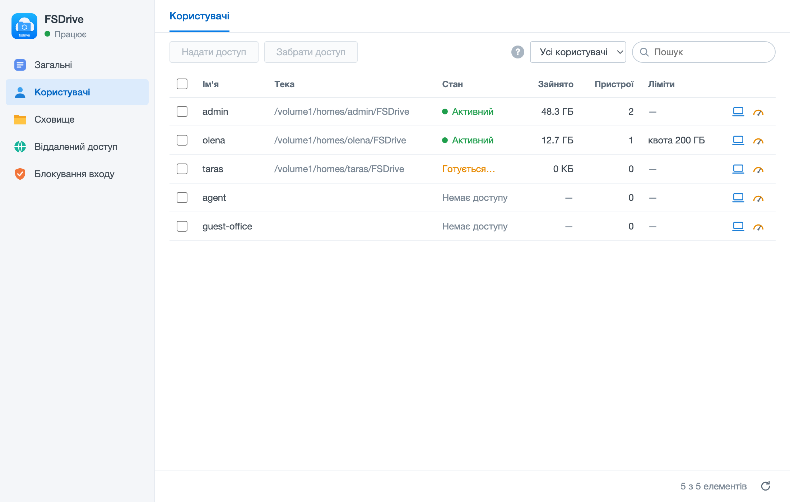

# FSDrive for Synology (DSM 7)

FSDrive turns your NAS into your own cloud. The server runs on the NAS, and the Mac client shows your files in Finder like iCloud Drive, downloading them on demand. On the NAS the files stay plain folders in a share or home folder you choose, so they remain reachable over SMB, in File Station and without FSDrive. Users sign in with their NAS accounts; the administrator chooses who may use FSDrive, sets quotas and file size limits, and can disconnect any device. Outside the local network devices connect through port forwarding, an HTTPS reverse proxy or an SSH gateway, encrypted with the server key. Settings open from the main menu.



This repository holds only the built package site, served at <https://romulas-12.github.io/fsdrive-packages-synology/>; the source code is in
[FSDrive](https://github.com/Romulas-12/fsdrive). It is regenerated and replaced on every release; do not edit it by hand.

## Install

Package Center → Settings → General → Trust Level: Any publisher. Then Package Center → Settings → Package Sources → Add, name FSDrive, location: the URL for your NAS's processor below (Intel or AMD: x86_64, ARM: armv8). FSDrive appears under Community. After installing, open FSDrive from the main menu and finish the one-time setup it shows.

x86_64:

```
https://romulas-12.github.io/fsdrive-packages-synology/x86_64.json
```

armv8:

```
https://romulas-12.github.io/fsdrive-packages-synology/armv8.json
```

Version 0.4.2. To install manually, download the package for your NAS:

| Arch | Package | SHA-256 |
|---|---|---|
| x86_64 | [FSDrive_0.4.2_x86_64.spk](https://romulas-12.github.io/fsdrive-packages-synology/FSDrive_0.4.2_x86_64.spk) | `b668721b10b53c0458c2c430ff004fec4756ed530b0685b90a992704418ceb67` |
| armv8 | [FSDrive_0.4.2_armv8.spk](https://romulas-12.github.io/fsdrive-packages-synology/FSDrive_0.4.2_armv8.spk) | `f89ba162969e9bec351bac496dbe2038b6084eb0a54992e33309afddba49a473` |

The package is not signed by the NAS vendor, so the app store shows a "no digital signature" notice.


## Встановлення

Package Center → Settings → General → Trust Level: Any publisher. Потім Package Center → Settings → Package Sources → Add, назва FSDrive, адреса — для процесора вашого NAS (Intel чи AMD: x86_64, ARM: armv8). FSDrive з'явиться в розділі Community. Після встановлення відкрийте FSDrive з головного меню й виконайте одноразове налаштування, яке він покаже.

License: AGPL-3.0.
